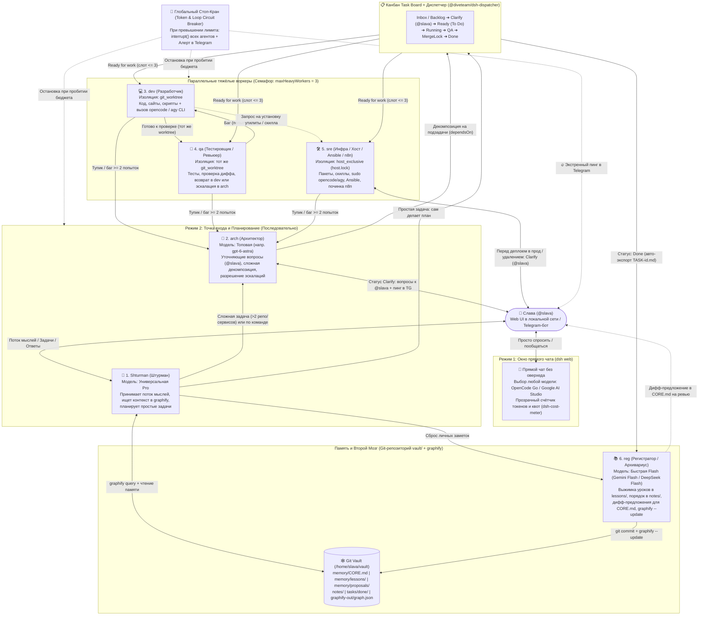
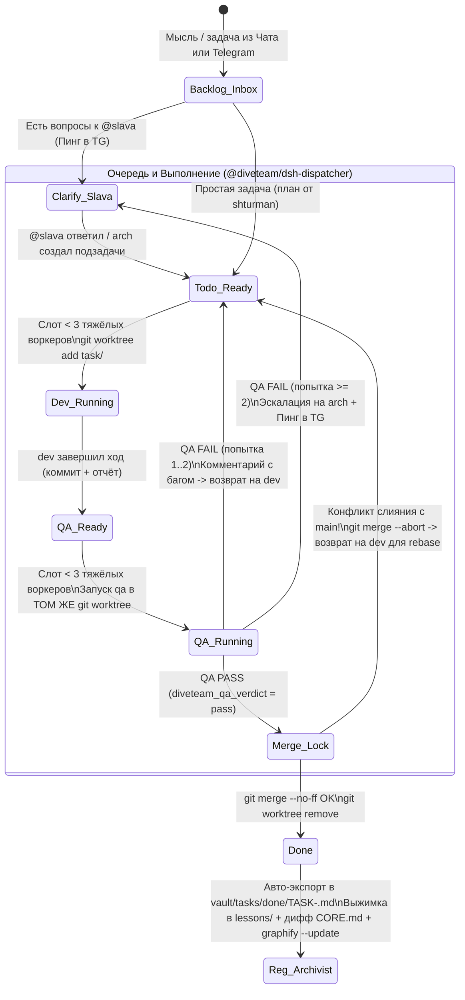

# Архитектура автономной ИИ-системы «DiveTeam» (DiveTeam AI)

> **Статус документа:** Утверждённая целевая архитектура (по итогам 3 раундов брейншторма и разбора `ARCHITECTURE_REVIEW.md`)
> **Базовая платформа:** [DeepSeek Harness (`dsh`)](https://github.com/deepseek-ai/deepseek-harness)
> **Стратегия развёртывания:** Локальная сборка и обкатка на рабочей станции (`p1-arch`) $\to$ Переносимая сборка (Bundle) $\to$ Боевой инстанс Raspberry Pi 5 (`farvater`, `192.168.0.55`, 8 ГБ ОЗУ)

---

## 1. Контекст, цели и почему не подошли Hermes и Paperclip

Система создаётся для 1–3 пользователей под реальный ИТ-скоуп задач владельца (`@slava`):
- Написание, отладка и тестирование скриптов, сервисов и сайтов с последующим деплоем.
- Модификация кода **Ansible**, выкатка изменений в инфраструктуру и проверка деплоев.
- Обслуживание хоста `farvater` (установка системных пакетов, утилит, библиотек, скиллов) и починка упавших детерминированных автоматизаций в **`n8n`** (работающем в Docker на том же хосте).
- Декомпозиция сложных технических и личных идей в пошаговые планы и подзадачи.
- Приём «потока мыслей» (из веб-панели и на бегу из Telegram), наведение порядка в личных заметках и накопление долгосрочной памяти по решённым задачам.

### Уроки предыдущих систем (анти-паттерны, которые исключены в «DiveTeam»)
1. **Проблема Hermes AI (Prompt Bloat и жёсткая дрессировка):**
   - Огромные системные инструкции (20+ КБ запретов и правил выбора инструментов) сбивают современные модели с толку и сжигают десятки тысяч токенов впустую.
   - Навязчивый ревьюер памяти, запускающийся каждые несколько сообщений прямо посреди диалога без возможности гибко задать ему дешёвую модель и правила.
   - **Решение в «DiveTeam»:** Инвариант `dsh` *«Model-visible ⟺ logged»* (в промпт летит только то, что явно задано). Каждая роль описывается лаконичным промптом (15–30 строк) в чистом `.md` файле. Агент-архивариус (`reg`) работает на быстрой Flash-модели строго по событию закрытия задачи (`Done`) или по прямой команде.
2. **Проблема Paperclip AI (Корпоративный оверхед на простые вопросы и слепая трата бюджета):**
   - Смешивание простого чата с тяжёлым конвейером задач: на вопрос «Привет, работаешь?» система выбирала самую дорогую модель, плодила подзадачи и сжигала >500 000 токенов.
   - **Решение в «DiveTeam»:** Жёсткое разделение **Окна прямого чата** (тонкий диалог с выбранной моделью без создания задач и бюрократии) и **Канбан-оркестратора** (включается только тогда, когда задача реально ставится на доску). Плюс двухуровневое разделение планировщиков (`shturman` на универсальной Pro-модели vs `arch` на дорогой модели только для сложной архитектуры).

---

## 2. Высокоуровневая схема архитектуры



---

## 3. Платформа, доступ из локальной сети и маршрутизация ИИ-моделей

### 3.1. Веб-панель и доступ по LAN
- В качестве ядра используется **DeepSeek Harness (`dsh`)** с веб-интерфейсом (`@deepseek-ai/dsh-web-app`).
- Для доступа к панели со всех устройств локальной сети (`https://192.168.0.55:3443` на `farvater` или локальный порт на `p1-arch`) используется плагин **`dsh-gateway`**:
  - Терминирует HTTPS, обеспечивает вход по паролю/токену и корректно подменяет заголовки `Host`/`Origin` для прохождения внутренней защиты `dsh` (`browser-trust fence`) при работе по WebSockets.

### 3.2. Подключение провайдеров (OpenCode Go + Google AI Studio)
Система объединяет два основных источника моделей в едином селекторе:
1. **OpenCode Go (`OPENCODE_GO_API_KEY`):**
   - Подключается через нативный провайдер `@deepseek-ai/dsh-llm-pi-ai` (и/или проверенный плагин `dsh-opencode-go` для синхронизации каталога моделей и заголовков сессии).
   - Плагин `dsh-cost-meter` отображает прямо в шапке веб-панели полосу расхода квоты подписки OpenCode Go (5-часовое окно, недельный и месячный лимиты).
2. **Google AI Studio (`GEMINI_API_KEY`):**
   - Подключается через `@deepseek-ai/dsh-llm-pi-ai` (провайдер `google` — модели линейки `gemini-2.5-flash`, `gemini-2.5-pro` и др.).
3. **Назначение моделей на роли и задачи:**
   - У каждой из 6 ролей в её конфигурационном файле `roles/<role>.md` прописаны `defaultProvider` и `defaultModel`.
   - При создании или редактировании любой карточки на Канбан-доске пользователь (или `arch`/`shturman`) может явно переопределить модель для конкретной задачи.
   - В обычном окне чата любую модель из обоих пулов можно выбрать в один клик в выпадающем списке.

---

## 4. Спецификация 6 ролей агентов

Роли определяются декларативно в файлах `roles/<role>.md` (YAML frontmatter + чистый Markdown-промпт роли) и регистрируются как **Agent Presets** в `dsh` (а также доступны для вызова как типизированные субагенты).

| № | ID роли | Название | Режим работы и квота | Режим изоляции | Уровень модели по умолчанию |
|---|---|---|---|---|---|
| **1** | `shturman` | **Штурман** (Точка входа и триаж) | Последовательно (вне квоты тяжёлых воркеров) | Чтение `vault/` + чат | Универсальная **Pro**-модель (OpenCode Go / Gemini Pro) |
| **2** | `arch` | **Архитектор** (Планировщик и эскалации) | Последовательно (вне квоты тяжёлых воркеров) | Чтение репо и `vault/` | Топовая **Reasoning**-модель (напр. `gpt-6-astra` и аналог) |
| **3** | `dev` | **Разработчик** | Параллельно (в квоте `maxHeavyWorkers: 3`) | `git_worktree` | Кодинг-модель из пула OpenCode Go |
| **4** | `qa` | **Тестировщик / Ревьюер** | Параллельно (в квоте `maxHeavyWorkers: 3`) | Тот же `git_worktree` | Ревью-модель из пула OpenCode Go |
| **5** | `sre` | **Инфра / Хост / Ansible / n8n** | В квоте `maxHeavyWorkers: 3` + мьютекс `host.lock` | `host_exclusive` | Инфра-модель из пула OpenCode Go |
| **6** | `reg` | **Регистратор / Архивариус** | По событию `Done` / по команде (вне квоты воркеров) | `notes_vault` (`vault/`) | Быстрая и дешёвая **Flash**-модель (`gemini-2.5-flash`) |

### Детальные обязанности и правила каждой роли

#### 🧭 1. `shturman` (Штурман)
- **Роль по умолчанию** при открытии веб-панели и единственный агент, к которому напрямую привязан живой диалог Telegram-бота.
- Принимает сырой поток мыслей, идеи, голосовые/текстовые заметки и задачи от `@slava`.
- Перед ответом или планированием ищет релевантный контекст в базе знаний через **`graphify query`** (и при необходимости читает файлы из `vault/`).
- **Правило фильтрации контекста (урок на 103k токенов):** `shturman` никогда не читает десятки сырых исходников в собственном окне чата; для разведки кода он вызывает короткоживущего субагента, получая от него сжатую сводку.
- **Чёткое правило маршрутизации (`shturman` $\to$ `arch`):**
  - `shturman` **обязан передать задачу на `arch`**, если выполняется хотя бы одно условие:
    1. Пользователь явно сказал отдать задачу Архитектору (`arch`).
    2. Задача затрагивает **более 2 репозиториев/сервисов** или требует проектирования новой архитектуры / схемы данных.
    3. Задача вернулась по эскалации после неудачных итераций `dev <-> qa`.
  - Если задача **простая и понятная** (один скрипт, точечная правка сайта, понятный багфикс): `shturman` сам пишет краткий план и сразу создаёт карточки в Канбане для `dev`, `qa`, `sre` или `reg`.
- Если сообщение пользователя — это просто мысль/заметка для «второго мозга» без технической задачи, `shturman` передаёт её роли `reg` для сохранения и категоризации в `vault/notes/`.

#### 📐 2. `arch` (Архитектор)
- Вызывается точечно для сложных задач и разруливания эскалаций, чтобы дорогая модель не тратила токены на рутину.
- **Фаза уточнения (`Clarify`):** Изучает задачу и архитектуру проекта. Если есть развилки или неясности — формулирует конкретный список вопросов к человеку, записывает их в карточку, переводит статус в `Clarify` с назначением на **`@slava`** и отправляет пинг в Telegram.
- **Фаза декомпозиции:** После получения ответов от `@slava` пишет архитектурный план в карточку родительской задачи и разбивает её на атомарные подзадачи (`subtasks`) в `task-board`, указывая для каждой:
  - роль исполнителя (`dev`, `qa`, `sre`, `reg`);
  - режим изоляции (`git_worktree`, `host_exclusive`, `notes_vault`) и целевой репозиторий (`repoPath`);
  - зависимости (`dependsOn`), чтобы зависимые задачи стартовали строго после закрытия предыдущих.
- **Разбор эскалаций:** Когда `dev`, `qa` или `sre` заходят в тупик (или `qa` дважды возвращает задачу `dev`), карточка попадает к `arch`. Архитектор анализирует логи попыток, меняет план/подход или эскалирует вопрос на `@slava`.

#### 💻 3. `dev` (Разработчик)
- Работает параллельно с другими воркерами, но **строго внутри выделенного `git worktree`** своей задачи (`worktrees/<repo>/task-<id>`, ветка `task/<id>`).
- Пишет и модифицирует код, скрипты, конфиги и сайты.
- **Инструменты и делегирование в CLI:**
  - Имеет базовые инструменты `dsh` (`bash`, `fs`, `fs-search`, `jobs`) для быстрых правок.
  - Имеет прямой доступ к вызову **`opencode` CLI** (`opencode run ...` или через ACP-субагента) и **`agy` CLI** внутри своей рабочей директории `worktree` для выполнения объёмного кодинга и рефакторинга.
- **Взаимодействие с `sre`:** Если в процессе разработки выясняется, что на хосте не хватает компилятора, системной библиотеки, CLI-утилиты или скилла — `dev` не пытается ставить системные пакеты вслепую, а создаёт/запрашивает подзадачу для `sre` (или эскалирует потребность через комментарий задачи).
- По завершении работы коммитит изменения в ветку `task/<id>`, пишет в карточку краткий отчёт о сделанном (`handover`) и передаёт эстафету тестировщику (`qa`).

#### 🧪 4. `qa` (Тестировщик / Ревьюер)
- Запускается автоматически в **том же самом `git worktree`**, где только что отработал `dev`.
- Проверяет `git diff main...HEAD`, запускает автотесты, линтеры, сборку проекта или проверочный прогон скрипта.
- **Правило разделения обязанностей:** `qa` не переписывает код молча вместо `dev`. По итогам проверки `qa` выносит формальный вердикт (`diveteam_qa_verdict`):
  - **`pass` (Успех):** Оставляет комментарий с результатами тестов в карточке; задача автоматически переходит на стадию последовательного слияния (`merge.lock` $\to$ `git merge --no-ff` в `main` $\to$ удаление `worktree` $\to$ `Done`).
  - **`fail` (Найден баг):** Пишет подробный баг-репорт в комментарий карточки и возвращает задачу обратно на `dev` (в тот же `worktree` на доработку). Если `attemptCount >= 2` (две итерации `dev <-> qa` подряд завершились провалом) — задача автоматически эскалируется на `arch` со статусом `Clarify` и уведомлением в Telegram.

#### 🛠️ 5. `sre` (Инфраструктура / Хост / Ansible / n8n)
- Отвечает за всё, что выходит за рамки изолированного кодинга в одном репозитории и касается самого хоста (`farvater` / локального стенда) и инфраструктуры:
  1. **Управление хостом и установка инструментов/скиллов:** Устанавливает системные пакеты (`apt`/`pacman`), библиотеки, CLI-утилиты и новые агентские **скиллы** по запросу других агентов или пользователя.
  2. **Эскалация привилегий для CLI:** Имеет право вызывать **`opencode` CLI** и **`agy` CLI с рутовыми правами (`sudo agy --dangerously-skip-permissions`)** для глубокой системной диагностики и настройки.
  3. **Инфраструктура как код (Ansible):** Модифицирует роли и плейбуки Ansible, прогоняет проверки `ansible-playbook --check --diff`, выкатывает изменения в инфраструктуру и проверяет состояние сервисов после выкатки.
  4. **Починка и обслуживание `n8n` в Docker:** На `farvater` в `n8n` крутятся строгие без-ИИ автоматизации по расписанию и вебхукам. Если автоматизация в `n8n` падает — создаётся задача на `sre`. Агент проверяет контейнер Docker, читает логи/ошибки исполнения в `n8n`, чинит упавший воркфлоу или окружение и проверяет работоспособность.
- **Эксклюзивная блокировка (`host.lock`):** Любая задача `sre` в режиме `host_exclusive` перед стартом захватывает системный лок-файл `/tmp/diveteam-host.lock` (или `/run/lock/farvater-host.lock`), чтобы два `sre`-агента никогда не ломали пакетный менеджер или Docker параллельно.
- **Гейт безопасности `sre` (Approval Gate — Решение Q2, Вариант 2):**
  - Полная автономия на чтение логов, диагностику, установку недостающих для работы утилит/скиллов и тестовые прогоны (`--check` / `dry-run`).
  - **Обязательный стоп перед продом/удалением:** Перед боевой выкаткой плейбука на прод, перезапуском критичных боевых сервисов или удалением данных `sre` обязан вызвать инструмент запроса аппрува (`diveteam_request_approval`), который переводит карточку в `Clarify` на `@slava`, освобождает `host.lock` и присылает в Telegram точный список команд на утверждение (`/approve` / `/reject`).

#### 📚 6. `reg` (Регистратор / Агент-Архивариус)
- Работает на дешёвой и быстрой Flash-модели в режиме изоляции `notes_vault` (папка `/home/slava/vault`).
- **Сценарий 1 — Авто-выжимка при закрытии задачи (`Done`):**
  - Когда любая задача на доске переходит в `Done`, диспетчер автоматически экспортирует полную карточку задачи (описание, промпт, все комментарии `dev`/`qa`/`sre`/`arch` и итог) в Markdown-файл `vault/tasks/done/TASK-<id>.md`.
  - Просыпается `reg`, читает этот файл и создаёт лаконичную заметку-урок в `vault/memory/lessons/YYYY-MM-DD-<slug>.md` (в чём была суть, как решили, какие грабли нашли, чтобы не наступать повторно).
- **Сценарий 2 — Предложение правил в `CORE.md` через дифф (Решение Q4):**
  - Чтобы дешёвая Flash-модель никогда не засорила и не сломала главный промпт памяти `vault/memory/CORE.md`, у `reg` **запрещена прямая запись в `CORE.md`**.
  - Если `reg` считает, что найденное правило нужно занести в базовую память `CORE.md`, он вызывает инструмент `diveteam_propose_core_diff`, который создаёт файл `vault/memory/proposals/CORE-diff-<id>.md` с наглядным `diff`-блоком и присылает превью Славе в Telegram.
  - Слава сам смотрит дифф и решает: применить его вручную, дать команду `shturman` («Штурман, проверь и примени дифф в `CORE.md`») или проигнорировать.
- **Сценарий 3 — Наведение порядка в личных записях (`vault/notes/`):**
  - По команде от `shturman` или пользователя разбирает сырые заметки из `vault/inbox/`, раскладывает их по тематическим файлам в `vault/notes/`, расставляет теги и `[[вики-ссылки]]`.
- **Финализация в Git и `graphify`:**
  - После каждого обновления файлов в `vault/` делает атомарный `git commit` (всегда можно посмотреть `git diff` или откатить `git revert`) и запускает инкрементальный **`graphify --update`**, обновляя граф знаний `graphify-out/graph.json`.

---

## 5. Канбан-доска, коммуникация агентов и жизненный цикл задачи

### 5.1. Архитектура связки `ui-task-board` + `@diveteam/dsh-dispatcher`
По результатам аудита и ревью (`Q1`) принято решение **не форкать и не переписывать React-компоненты** плагина `@linxin666/dsh-client-ui-task-board`, чтобы не ломать сборку при обновлениях `dsh`:
1. **UI-слой (`@linxin666/dsh-client-ui-task-board`):**
   - Используется как готовое визуальное ядро Канбана внутри веб-панели `dsh` (с предварительной вырезкой телеметрии `dsh-market.com` и отключением скрытого LLM-судьи `goalVerification: false`).
   - Хранит карточки в `~/.dsh/profiles/<profile>/data/task-board/ledger-v2.json` с атомарным файловым локом `ledger-v2.lock` и транзакционной очередью записи.
   - Поддерживает дерево подзадач (`parentId`, `maxSubtaskDepth: 3`), зависимости, привязку пресета роли (`mode`) и модели (`model`), передачу контекста (`handover`) и расширение `integrations['diveteam']`.
2. **Серверный плагин-оркестратор (`@diveteam/dsh-dispatcher`):**
   - Подключается к доске через штатный контракт `ctx.taskBoard.registerExtension(TaskBoardExtension)`.
   - Полностью берёт на себя конечный автомат движения карточек, пул воркеров, создание/слияние `git worktree`, блокировку `host.lock`, комментарии к карточке и интеграцию с `vault/` и Telegram.

### 5.2. Обмен сообщениями и комментариями внутри задачи
Агенты разных ролей (`shturman`, `arch`, `dev`, `qa`, `sre`) и человек (`@slava`) общаются в едином контексте задачи:
- Каждый переход между этапами (вопрос от `arch`, отчёт `dev` о сделанных коммитах, баг-репорт от `qa`, запрос аппрува от `sre`, ответ `/approve` или комментарий от `@slava`) дописывается с таймстампом и автором в **Журнал комментариев карточки** (как в тело описания карточки для наглядности в UI, так и в структурированный массив `integrations.diveteam.logs`).
- Когда следующая роль (например, `qa` после `dev`, или `dev` после возврата от `qa`, или `arch` при эскалации) запускается Диспетчером, ей в промпт задачи автоматически передаётся вся история комментариев предыдущих ролей и ссылка на рабочую ветку/`worktree`.

### 5.3. Статусы/колонки и конечный автомат задачи (State Machine)

В UI доски используются 5 базовых колонок (`Backlog`, `To Do`, `Running`, `Done`, `Failed`) в сочетании с фазами Диспетчера (`integrations.diveteam.phase`), которые однозначно отображают все рабочие состояния:

| Визуальная колонка в UI | Фаза (`diveteam.phase`) | На ком висит | Что происходит в этот момент |
|---|---|---|---|
| **Backlog** | `draft` / `inbox` | `shturman` | Сырая идея или сброс мыслей, ещё не запущенный в работу. |
| **Backlog** *(с бейджем `⏸️ Clarify @slava`)* | `clarify` | `@slava` или `arch` | **Задача повешена на человека** (уточняющие вопросы от `arch`/`shturman`, запрос аппрува от `sre`) либо эскалирована на `arch`. Отправлен пинг в Telegram. Авто-запуск заблокирован до ответа. |
| **To Do** | `ready` / `qa_ready` | `dev` / `qa` / `sre` / `arch` | Задача готова к выполнению (`Ready for work`), все её зависимости (`dependsOn`) выполнены. Ждёт свободного слота в пуле воркеров. |
| **Running** | `dev_running` / `qa_running` / `sre_running` / `merge_pending` | Активная роль | Задача прямо сейчас выполняется агентом в изолированной сессии (или проходит `merge.lock` после `QA Pass`). |
| **Done** | `done` | `reg` (авто-триггер) | Код влит в `main`, `worktree` удалён, карточка экспортирована в `vault/tasks/done/TASK-<id>.md`, запущен архивариус `reg`. |
| **Failed** | `failed` | `@slava` / `arch` | Остановлено пользователем (`/reject`), сработал стоп-кран или критическая ошибка запуска. |



---

## 6. Три режима изоляции, сериализация слияний и конкурентность

### 6.1. Квота параллельных воркеров на 8 ГБ RAM (`maxHeavyWorkers: 3`)
- В `dsh` сами сессии агентов работают внутри одного процесса Node.js и почти не расходуют память во время ожидания ответа от API моделей. Память на Raspberry Pi 5 потребляют дочерние процессы сборки/тестов (`npm`/`pnpm`, `pytest`, `docker`, `opencode`/`agy` CLI).
- Поэтому семафор `maxHeavyWorkers = 3` ограничивает **только тяжёлые роли (`dev`, `qa`, `sre`)**.
- Одновременно может выполняться не более 3 тяжёлых задач. Четвёртая задача остаётся в `To Do` и стартует автоматически в момент освобождения любого слота.
- Лёгкие роли (**`shturman`, `arch`, `reg`**) работают **вне этой квоты** — Штурман всегда мгновенно отвечает в чате/Telegram, а Архивариус сразу обрабатывает закрытые задачи, даже если все 3 слота воркеров заняты.

### 6.2. Три режима изоляции рабочих директорий + `merge.lock`
1. **`git_worktree` (для `dev` и `qa`):**
   - При старте `dev` Диспетчер создаёт изолированное рабочее дерево:
     `git worktree add -b task/<shortId> <worktreesRoot>/<repoSlug>/task-<shortId> <baseBranch>`.
   - Два параллельных `dev`-агента работают в разных папках и разных ветках одного репозитория — физически невозможна перезапись файлов друг друга.
   - Перед передачей задачи в `qa` Диспетчер проверяет незакоммиченные файлы в `worktree` (при наличии делает страховочный снапшот-коммит) и запускает `qa` в этой же папке.
   - **Последовательный мьютекс слияния (`merge.lock`):**
     Когда `qa` выносит вердикт `pass`, слияние ветки `task/<shortId>` обратно в `main` выполняется строго по одному через внутрипроцессную очередь `MergeLockQueue`:
     - Выполняется `git merge --no-ff task/<shortId>`.
     - Если слияние прошло чисто — удаляется `worktree` (`git worktree remove --force`) и ветка `task/<shortId>`, карточка переходит в `Done`.
     - Если параллельная задача успела влить изменения в те же строки и возник **конфликт слияния** — Диспетчер автоматически выполняет `git merge --abort`, пишет комментарий о конфликте в карточку и возвращает задачу на `dev` с инструкцией выполнить `git rebase main`, разрешить конфликт и снова пройти `qa`.
2. **`host_exclusive` (для `sre`):**
   - Захватывает атомарный файловый мьютекс `/tmp/diveteam-host.lock`, содержащий `{ pid, taskId, acquiredAt }`.
   - Пока один `sre` выполняет операции на хосте, любая другая задача `sre` ждёт в очереди `To Do` (при этом задачи `dev`/`qa` в `git_worktree` продолжают идти параллельно в рамках общих 3 слотов).
3. **`notes_vault` (для `reg` и заметок):**
   - Работа ведётся внутри Git-репозитория `/home/slava/vault` (локально на этапе тестов — `./vault`).
   - Каждая сессия `reg` завершается `git add -A && git commit` и обновлением графа `graphify --update`.

### 6.3. Startup Janitor (Восстановление после рестарта/сбоя)
При каждом запуске `dsh` Диспетчер выполняет процедуру самолечения (`runStartupJanitor`):
- Проверяет `/tmp/diveteam-host.lock`: если PID процесса в лок-файле мёртв — удаляет осиротевший лок.
- Выполняет `git worktree prune` по рабочим репозиториям.
- Находит карточки, застрявшие в статусе `Running` при отсутствии живой сессии (например, после перезагрузки сервера), и безопасно возвращает их в `To Do` (`phase: ready`), чтобы они продолжили выполнение.

---

## 7. Память («Второй мозг»), `vault/` и граф знаний `graphify`

Хранилище знаний полностью файловое (Git + Markdown + JSON-граф `graphify`), без внешних векторных БД и фоновых демонов вроде OpenViking:

```text
vault/                          # Git-репозиторий памяти и заметок
├── inbox/                      # Сырые сбросы мыслей из Telegram и Веб-панели
├── notes/                      # Личные заметки, идеи, списки (Obsidian-совместимые .md)
├── tasks/
│   └── done/                   # Авто-экспорт закрытых карточек: TASK-<id>.md
├── memory/
│   ├── CORE.md                 # Компактная базовая память (~500–1500 токенов), всегда в промпте ролей
│   ├── lessons/                # Технические выжимки от reg по закрытым задачам (YYYY-MM-DD-*.md)
│   └── proposals/              # Дифф-предложения от reg для CORE.md (CORE-diff-<id>.md)
└── graphify-out/
    ├── graph.json              # Персистентный граф знаний (строится через graphify --update)
    └── GRAPH_REPORT.md         # Сводка узлов и связей графа
```

### Как работает цикл памяти от задачи до поиска:
1. **Завершение задачи (`Done`)** $\to$ Диспетчер сохраняет `vault/tasks/done/TASK-<id>.md`.
2. **Дистилляция (`reg`)** $\to$ Создаёт сжатый технический урок в `vault/memory/lessons/` (и опционально дифф-предложение в `vault/memory/proposals/CORE-diff-<id>.md` без правки самого `CORE.md`).
3. **Индексация (`graphify --update`)** $\to$ Связывает новые уроки, заметки из `notes/` и отчёты задач в единый граф `graphify-out/graph.json`.
4. **Поиск контекста (`shturman` / `arch`)** $\to$ При поступлении новой задачи или мысли из Telegram Штурман вызывает `graphify query "..."`, мгновенно находя связанные прошлые задачи, грабли и заметки.

---

## 8. Интеграция с Telegram, Стоп-Кран по токенам и Безопасность

### 8.1. Двусторонний Telegram-мост
Telegram-бот выполняет две функции одновременно:
1. **Входящий поток (Мысли, Задачи и Управление на ходу):**
   - Любое обычное сообщение (или голосовая заметка) от `@slava` сохраняется в `vault/inbox/` и передаётся **`shturman`**: Штурман отвечает прямо в Telegram, раскладывает мысли в заметки (`reg`) или создаёт карточки задач.
   - Быстрые команды управления карточками прямо с телефона:
     - `/approve <id>` — одобрить задачу, висящую в `Clarify` на `@slava` (например, разрешить `sre` выкатку в прод или подтвердить план), и вернуть её в очередь `To Do`.
     - `/reject <id> <причина>` — отклонить и остановить задачу.
     - `/status` — посмотреть активные воркеры, очередь задач и текущий расход токенов за сутки.
2. **Исходящие проактивные уведомления (`@slava`):**
   - При переходе карточки в `Clarify` (вопросы от `arch` / `shturman`).
   - При запросе аппрува от `sre` перед деплоем/удалением (`diveteam_request_approval`).
   - При эскалации задачи на `arch` после 2 неудач `dev <-> qa`.
   - При появлении нового `diff`-предложения в `CORE.md` от `reg` (`diveteam_propose_core_diff`).
   - При срабатывании Глобального Стоп-Крана по токенам.

### 8.2. Счётчики токенов и Глобальный Стоп-Кран (Circuit Breaker)
1. **Устранение скрытых пожирателей токенов:**
   - Полностью удалены/отключены `@openviking/dsh-memory-plugin` (+3200 скрытых токенов на каждый шаг) и `aegis`.
   - В `ui-task-board` жёстко выключен `goalVerification: false` (экономия 6–12 вызовов LLM-судьи на каждую задачу) и `announceToAgent: false`.
2. **Мониторинг и защита от зацикливания:**
   - `dsh-cost-meter` считает стоимость сессий и лимиты подписки OpenCode Go.
   - Защита от зацикливания тулов (`loop guard`) прерывает агента, если он повторяет одинаковый вызов инструмента с ошибкой несколько раз подряд.
3. **Глобальный Стоп-Кран (`maxDailyTokens` / Budget Circuit Breaker):**
   - В Диспетчере задаётся общий лимит токенов (например, `maxDailyTokens: 2_000_000` или настраиваемый порог на волну задач).
   - Диспетчер слушает все события расхода токенов (`session/event`). Как только суммарный расход пересекает порог:
     1. Выставляется флаг `circuitBreakerTripped = true` (очередь новых задач блокируется).
     2. У всех активных агентов немедленно вызывается `agent.interrupt()`.
     3. В Telegram уходит экстренный алерт: *«🚨 [СТОП-КРАН ФАРВАТЕР] Превышен лимит токенов. Все агенты остановлены, очередь на паузе»*.

### 8.3. Политика информационной безопасности
- **Обязательный аудит сторонних плагинов:** Ни один плагин из комьюнити-маркета `dsh` не включается в сборку вслепую. Исходный код каждого плагина проверяется на внешние сетевые вызовы, телеметрию (например, стук на `https://dsh-market.com/api/telemetry/event` в плагинах `@linxin666/*`) и скрытые инъекции в промпт. Вся найденная телеметрия вырезается, а подозрительные плагины заменяются собственным прозрачным кодом.
- **Системная защита хоста `farvater`:** Сохраняются существующие аппаратно-системные предохранители Raspberry Pi 5 (запрет доступа к блочному устройству SD-карты `/dev/mmcblk0` в `sudoers`, `ReadOnlyPaths=/boot/firmware`, хранение секретов через `systemd-creds` в RAM `/dev/shm`).

---

## 9. Двухэтапный конвейер сборки: Локальная машина (`p1-arch`) $\to$ Боевой `farvater` (RP5)

Чтобы не отлаживать сырой код по сети на Raspberry Pi 5, система строится по принципу **Local-First Release Bundle**:
1. **Этап А (Локальный стенд на `p1-arch`):**
   - Вся разработка, аудит плагинов, настройка 6 ролей, `vault/`, `graphify`, Telegram-моста и плагина `@diveteam/dsh-dispatcher` выполняются локально в `/home/slava/Projects/Hermes_N8N_rp5` и локальном профиле `~/.dsh/profiles/deskweb`.
   - Локально прогоняются автоматические тесты и **5 сквозных сценариев (Golden Tasks)** в браузере.
2. **Этап Б (Упаковка проверенной рабочей «сборки»):**
   - Как только локальная сборка полностью устроила владельца в живых тестах, скрипт сборки упаковывает самодостаточный релизный архив (`diveteam-bundle.tar.gz`), включающий:
     - очищенные от телеметрии плагины и `@diveteam/dsh-dispatcher`;
     - скомпилированный конфиг профиля (`cordis.patch.yml` с пресетами 6 ролей и `package.json`);
     - структуру `roles/*.md` и стартовый репозиторий `vault/`;
     - `systemd`-юнит для автозапуска `dsh` на `farvater` с подхватом секретов из `/dev/shm`.
3. **Этап В (Перенос на `farvater` `192.168.0.55`):**
   - Архив копируется на Raspberry Pi 5, разворачивается установочным скриптом с авто-заменой путей `/home/slava/Projects/Hermes_N8N_rp5` $\to$ `/home/slava/farvater`, и запускается как системный сервис, доступный в локальной сети.
