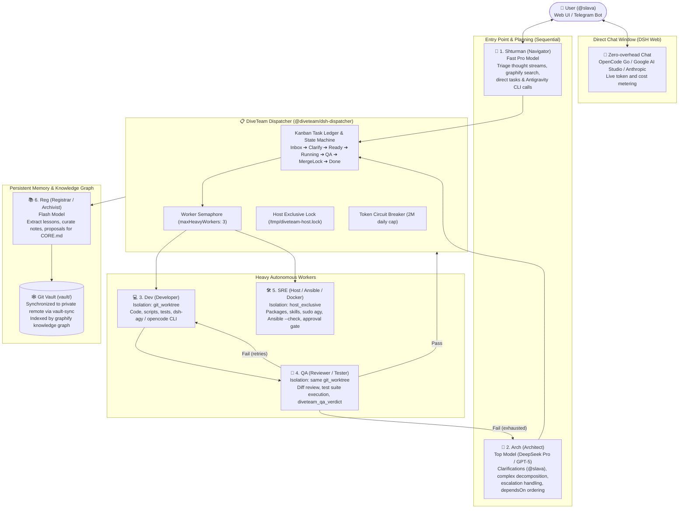

# 🌊 DiveTeam: Multi-Agent Autonomous Orchestration for DeepSeek Harness (DSH)

[](https://nodejs.org)
[](https://github.com/deepseek-ai/deepseek-harness)
[](https://opensource.org/licenses/MIT)
[](#agent-roles)

**DiveTeam** is an enterprise-grade multi-agent orchestrator, interactive Kanban board, workflow engine, Telegram bridge, and persistent memory subsystem designed as a suite of plugins for [DeepSeek Harness (`dsh`)](https://github.com/deepseek-ai/deepseek-harness).

DiveTeam enables autonomous collaborative engineering: AI agents independently take on specialized roles (Navigator, Architect, Developer, QA Reviewer, SRE Infrastructure Engineer, and Knowledge Registrar) to develop, test, review, and merge code in isolated Git worktrees, manage host infrastructure under lock protection, and synchronize insights into a persistent Git knowledge graph.

---

## 📑 Table of Contents
1. [Key Capabilities](#-key-capabilities)
2. [System Architecture](#-system-architecture)
3. [Agent Roles](#-agent-roles)
4. [Quick Start & Installation](#-quick-start--installation)
5. [Packages Breakdown](#-packages-breakdown)
6. [Web UI Control Panel](#-web-ui-control-panel)
7. [Workflow Engine & State Machine](#-workflow-engine--state-machine)
8. [CLI Tools Reference](#-cli-tools-reference)
9. [Telegram Integration](#-telegram-integration)
10. [Security & Credential Management](#-security--credential-management)
11. [Troubleshooting & FAQ](#-troubleshooting--faq)

---

## 🌟 Key Capabilities

- **Isolated Git Worktrees:** Development and testing run inside disposable, isolated worktrees (`worktrees/<repo>/task-<id>`). Main branches are never touched directly by worker agents.
- **Atomic Merge Lock:** When QA approves changes, the dispatcher acquires an exclusive `merge.lock`, performs `git merge --no-ff`, removes the worktree, and notifies the registrar.
- **Worker Concurrency Semaphore:** Restricts heavy parallel tasks (Dev, QA, SRE) to a configurable pool (default: 3 concurrent workers) to protect host CPU and RAM.
- **SRE Host Exclusive Lock (`host.lock`):** Ensures infrastructure tasks (package management, Docker, systemd, Ansible) never run concurrently or conflict.
- **Approval Gate (`Clarify` Phase):** Risky operations (destructive commands, Ansible production deploy, architectural forks) halt execution, transition to `Clarify (@slava)`, and request human authorization via Telegram or Web UI.
- **Circuit Breaker:** Daily token consumption limits prevent budget runaway.
- **KDE Wallet & Secure Credentials:** Zero plain-text tokens on disk. GitHub PAT and Telegram Bot tokens are read on-the-fly from KDE Wallet (`kdewallet`) or RAM (`/dev/shm`).
- **Interactive Workflow Schema:** Visual pipeline graph with configurable auto-merge, retries, and escalation rules.
- **Dynamic Role Management:** Create, configure, and assign tasks to custom agent roles directly from the UI or chat.
- **Bi-directional Telegram Bridge:** Chat directly with the Navigator (`shturman`), approve pending decisions with `/approve <id>`, reject with `/reject <id>`, and inspect tasks with `/status`.

---

## 🏛 System Architecture



---

## 👥 Agent Roles

| Role | Name | Default Isolation | Heavy Worker | Responsibilities |
|---|---|---|:---:|---|
| **`shturman`** | 🧭 1. Shturman (Navigator) | `none` | ❌ No | Entry point for Web & Telegram. Context lookup via `graphify`, simple task routing, direct `dsh-agy` CLI calls. |
| **`arch`** | 📐 2. Arch (Architect) | `none` | ❌ No | Multi-repository architectural planning, clarifying questions via `diveteam_request_approval`, task decomposition with `dependsOn`. |
| **`dev`** | 💻 3. Dev (Developer) | `git_worktree` | ✅ Yes | Writing code and tests inside isolated Git worktree (`task/<id>`). Delegates heavy coding to `dsh-agy run` or `opencode run`. |
| **`qa`** | 🧪 4. QA (Tester / Reviewer) | `git_worktree` | ✅ Yes | Runs tests and reviews diffs in the same worktree. Strictly forbidden from modifying code. Emits `diveteam_qa_verdict(pass/fail)`. |
| **`sre`** | 🛠️ 5. SRE (Infrastructure) | `host_exclusive` | ✅ Yes | Manages host packages, agent skills, systemd units, Docker, Ansible. Has access to `dsh-agy run --sudo`. Requires approval for prod changes. |
| **`reg`** | 📚 6. Reg (Registrar) | `notes_vault` | ❌ No | Distills lessons from `Done` tasks into `vault/memory/lessons/`, organizes notes, proposes changes to `CORE.md`, triggers `vault-sync`. |
| **`custom`** | ➕ Custom Roles | Configurable | Configurable | Add specialized roles (e.g. `designer`, `secops`, `data-analyst`) directly from the Web UI. |

---

## 🚀 Quick Start & Installation

### Prerequisites
- **Linux** (Arch Linux, Ubuntu 22.04/24.04, Debian 12/13, Raspberry Pi OS 64-bit)
- **Node.js >= 22.0.0** (`node -v`)
- **Git** (`git --version`)
- **DeepSeek Harness (`dsh`)** installed

### One-Command Installation on Any Host

```bash
# 1. Clone repository
git clone https://github.com/sviatoslav-shpirko/dsh-diveteam.git ~/Projects/dsh-diveteam
cd ~/Projects/dsh-diveteam

# 2. Run the automated installer for your DSH profile (default: deskweb)
./install.sh --profile deskweb
```

The installer will:
1. Verify Node.js version and DSH availability.
2. Build the frontend UI bundle (`tsdown`).
3. Wire `@diveteam/dsh-dispatcher` and `@diveteam/dsh-client-diveteam-ui` into your profile's `package.json`.
4. Symlink CLI helpers (`dsh-agy`, `dsh-github-token`, `dsh-git-credential-helper`, `dsh-telegram-token`, `vault-sync`) into `~/.local/bin`.
5. Link DiveTeam skills into `~/.dsh/skills/`.
6. Compile and inject role presets into your profile's `cordis.patch.yml`.
7. Initialize default `workflow-rules.json`.

### Starting DSH
```bash
# Run DSH interactively
dsh --profile deskweb

# Or if running as a systemd user service:
systemctl --user restart dsh-deskweb.service
```

Access the Web UI at **`http://127.0.0.1:3080`** and click the **DiveTeam** tab in the sidebar!

---

## 📦 Packages Breakdown

```
dsh-diveteam/
├── packages/
│   ├── dsh-dispatcher/            # Backend plugin: state machine, semaphore, host lock, telegram, tools
│   │   ├── lib/
│   │   │   ├── index.js           # Plugin lifecycle, Cordis service, HTTP routes, tools
│   │   │   ├── ledger.js          # Task ledger storage & CRUD operations
│   │   │   ├── worktree.js        # Git worktree lifecycle & merge.lock manager
│   │   │   ├── telegram.js        # Telegram bot polling, commands & whitelist
│   │   │   ├── roles.js           # Dynamic role parsing from roles/*.md
│   │   │   └── vault.js           # Knowledge vault inspection & diff proposals
│   │   └── test/
│   │       └── dispatcher.test.mjs# 10 comprehensive automated tests (node --test)
│   │
│   └── dsh-client-diveteam-ui/    # Frontend plugin: DSH Web GUI extension
│       ├── src/
│       │   ├── index.ts           # Server-side route handler (/diveteam/roles)
│       │   └── client/
│       │       ├── index.ts       # Sidebar slot registration & locale injection
│       │       ├── DiveTeamPanel.tsx # 6-tab main control panel
│       │       ├── TasksPanel.tsx    # Drag-and-drop Kanban task board & task editor
│       │       ├── WorkflowPanel.tsx # Interactive pipeline flow map & rules editor
│       │       ├── AgentsPanel.tsx   # Role prompts & custom role builder
│       │       ├── MonitoringPanel.tsx # Live metrics, semaphore, circuit breaker
│       │       ├── MemoryPanel.tsx   # Knowledge graph search & CORE.md proposals
│       │       └── TelegramPanel.tsx # Live bot status & diagnostics
│       └── tsdown.config.ts       # Bundler configuration
│
├── roles/                         # Agent role specifications (*.md)
├── scripts/                       # Shell & Node.js helper scripts
├── skills/                        # DiveTeam agent skills
├── install.sh                     # Automated setup script for any host
├── workflow-rules.json            # Pipeline routing rules & limits
└── README.md
```

---

## 🖥 Web UI Control Panel

The DiveTeam panel is embedded seamlessly into the DSH Web UI sidebar:

1. **📋 Tasks (Kanban Board):**
   - 5 columns: **Входящие / Бэклог**, **К выполнению**, **В работе**, **Готово**, **Ошибка**.
   - Russian phase badges: `📝 Черновик`, `⏸️ Уточнение (@slava)`, `⏳ Готово к запуску`, `💻 В разработке (dev)`, `🧪 Проверка QA`, `🛠️ Инфра (sre)`, `🔒 Слияние (merge.lock)`, `✅ Завершено`, `❌ Ошибка`.
   - Per-task drawer with logs, role re-assignment, subtasks, and dependency tree.
2. **📈 Monitoring:**
   - Real-time worker semaphore utilization (`0/3` to `3/3`).
   - Host lock status (`/tmp/diveteam-host.lock`).
   - Global Token Circuit Breaker gauge.
3. **🔀 Workflow Map & Rules Editor:**
   - Interactive flowchart visualizing transition logic: `Backlog` $\to$ `Dev` $\to$ `QA` $\to$ `MergeLock` $\to$ `Done` $\to$ `Reg`.
   - Adjustable settings: Max Heavy Workers, Max QA Retries, Auto-merge on Pass, SRE Approval Gate, Escalation thresholds.
4. **🎭 Agent Roles:**
   - Inspect active system prompts, models, and providers for all roles.
   - Built-in **«➕ Создать роль»** form to add custom agents.
5. **🧠 Memory Vault:**
   - Real-time query into the `graphify` knowledge graph.
   - Browse lessons learned and review pending `CORE.md` diff proposals.
6. **📱 Telegram Bridge:**
   - Live bot username and connection test.
   - Access whitelist validation.

---

## 🛠 CLI Tools Reference

All helper scripts reside in `scripts/` and are symlinked into `~/.local/bin`:

### `dsh-agy`
Universal bridge between DSH agents and Google Antigravity CLI (`agy`):
```bash
# Check status and environment
dsh-agy status

# List available models
dsh-agy models

# Run a task inside a repository
dsh-agy run --workdir /path/to/repo --role dev --effort high "Refactor auth module"

# Audit architecture without modifying files (plan mode)
dsh-agy run --workdir /path/to/repo --role arch --mode plan --effort high "Review PR #42"

# SRE privileged run (root with sanitized environment)
dsh-agy run --sudo --role sre "Fix systemd unit failure"
```

### `dsh-github-token` & `dsh-git-credential-helper`
Retrieves GitHub PAT from KDE Wallet (`kdewallet` folder `Git_tokens`, entry `github_first_test_token`) without ever printing it or storing it in plaintext:
```bash
# Check status, prefix, and permissions via GitHub API
dsh-github-token status
```

### `dsh-telegram-token`
Resolves Telegram bot token dynamically from KDE Wallet (`Telegram_bot_tokens/diveteam_shturman_bot`):
```bash
# Check bot connectivity
dsh-telegram-token status

# Send a notification to the owner
dsh-telegram-token send "Deployment completed successfully"
```

### `vault-sync`
Synchronizes knowledge vault with remote Git repository and updates the `graphify` knowledge graph:
```bash
# Query the knowledge graph
vault-sync query "merge lock"

# Update graph and push changes to remote
vault-sync -m "vault(reg): record new lesson on git worktrees"
```

---

## 📱 Telegram Integration

DiveTeam includes an integrated Telegram bot client that operates inside `@diveteam/dsh-dispatcher`:

- **Commands:**
  - `/status` — summary of active workers, queue size, and token usage.
  - `/tasks` — list of running and pending tasks.
  - `/approve <id>` — approve a task pending in `Clarify` status (e.g. SRE dry-run).
  - `/reject <id>` — reject a pending approval request.
  - *Plain text* — forwarded directly to **Shturman** for conversational triage and responses.
- **Security:**
  - Strict whitelist (`DIVETEAM_TG_CHAT_ID`, `DIVETEAM_TG_USER_ID`, default: `81815557`). Messages from non-whitelisted users are silently dropped.
  - Automatic formatting converts markdown tables into mobile-friendly structured lists with bold headers and emoji status badges.

---

## 🔒 Security & Credential Management

1. **No Tokens on Disk:** Neither the GitHub PAT nor the Telegram bot token are ever written to configuration files or git commits.
2. **KDE Wallet Integration:** Tokens are fetched into RAM on demand.
3. **Sanitized Environment:** When invoking sub-processes or `agy`, forbidden or sensitive environment variables (such as raw API keys) are sanitized before execution.
4. **SRE Host Lock:** Prevents race conditions during critical system changes.

---

## 🧪 Testing

Run the automated test suite covering all 10 core integration scenarios:

```bash
npm test
# or
node --test packages/dsh-dispatcher/test/dispatcher.test.mjs
```

---

## 📄 License

MIT © [Sviatoslav Shpirko](https://github.com/sviatoslav-shpirko)
